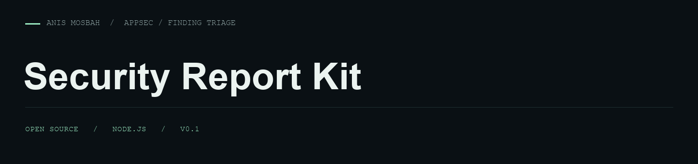
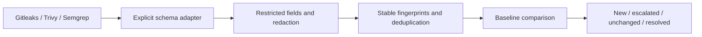

# Security Report Kit

### Turn scanner output into a reviewable change.

**Node.js 22+** · **MIT** · **v0.1.0** · [API](index.mjs) · [Tests](project.test.mjs)

Normalize **Gitleaks, Trivy and Semgrep** findings into a compact report, remove secret values and source snippets, then compare the current results to a reviewed baseline.

Use it to triage security changes in a pull request, prepare a shareable remediation report, or keep multiple scanner formats out of downstream automation.

## Supported adapters

| Input | Imported data | Omitted data |
| :--- | :--- | :--- |
| Gitleaks JSON array | Rule ID, file and start line. | Secret, match, author, email and commit fields. |
| Trivy JSON | Vulnerability ID, package, version, severity and reported fix. | Secret and misconfiguration result sections. |
| Semgrep JSON | Rule ID, location and severity. | Source lines, messages and metavariables. |

Known Gitleaks secret values are also redacted if they appear inside imported rule IDs or filenames. Arbitrary scanner objects are never copied wholesale into the report.

## Run

```sh
git clone https://github.com/anistack72/security-report-kit.git
cd security-report-kit
node cli.mjs --input gitleaks.json --source gitleaks --format json > baseline.json
node cli.mjs --input current.json --source gitleaks --baseline baseline.json --format html > review.html
node cli.mjs --input trivy.json --source trivy --fail-on critical --format markdown > findings.md
```

A report can be written while the command exits **1** because findings meet the failure threshold. Treat a baseline as a review decision, not a way to erase findings. Requires **Node.js 22+**, with no runtime dependencies. Source distribution only; not published to npm.



## Baseline behavior

`schemaVersion: 1` includes normalized `findings`, `checks` and a `delta`. Fingerprints use source, rule, file, line and component; moving a finding to another line can therefore create a new fingerprint. Duplicate findings are collapsed. A severity increase is **escalated** and is checked against the current failure threshold even when the fingerprint is already in the baseline.

Only new and escalated findings are gated when a baseline is supplied. The default threshold is `high`; accepted values are `info`, `low`, `medium`, `high` and `critical`. Semgrep reports containing analysis errors are rejected to avoid baselining incomplete coverage. Inputs are capped at 25 MiB by the CLI.

Exit codes: **0** no threshold failure, **1** a new or escalated finding reaches the threshold, **2** malformed report or invalid usage.

## Trust and attribution

This tool processes existing reports; it does not run scanners or establish scan coverage. Review file paths and component names before external sharing. Redaction of selected fields is not a general personal-data anonymizer.

The adapters integrate outputs from [Gitleaks](https://github.com/gitleaks/gitleaks), [Trivy](https://github.com/aquasecurity/trivy) and [Semgrep](https://github.com/semgrep/semgrep). Their code, engines, rules and trademarks remain their own. No scanner source code is bundled; this independently authored adapter code is MIT licensed.

## Reproducible demonstration

```sh
node demo.mjs
node demo.mjs html > demo-report.html
```

The demo is explicitly labeled **synthetic**. It uses temporary local data or controlled fixture responses, never a third-party target. The generated HTML is standalone, with no remote scripts, fonts or analytics.

## Development

```sh
npm run check
npm test
```

Tests use local fixtures and local HTTP servers. The included CI matrix targets Node.js 22 and 24 on Linux, macOS and Windows. A local test pass does not mean that every CI platform has already run.

See [CONTRIBUTING.md](CONTRIBUTING.md) for changes and [SECURITY.md](SECURITY.md) for private security reports.

---

Built by **Anis Mosbah** · [Professional enquiries](mailto:contact@anis-mosbah.dev) · [MIT license](LICENSE)
